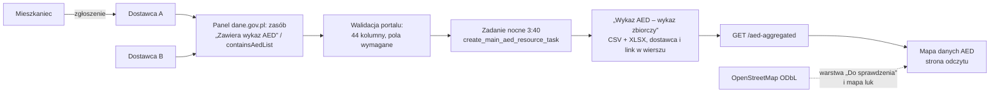

# Wykaz AED w dane.gov.pl + Mapa danych AED

> **Pierwszy raz? Nie programujesz?** Instrukcja krok po kroku dla Windows – instalacja, uruchomienie i sprawdzenie najważniejszych funkcji: [`INSTRUKCJA_URUCHOMIENIA.md`](INSTRUKCJA_URUCHOMIENIA.md).

**Prototyp online (tryb demonstracyjny, bez instalacji): https://serafin21.github.io/misja-aed/**

Zespół **MKS**, HackNation 2026, zadanie Ministerstwa Cyfryzacji „Misja AED – dane na ratunek”. **Jury: zacznij od [`INSTRUKCJA_DLA_JURY.md`](INSTRUKCJA_DLA_JURY.md).**

Rozwiązanie to **Wykaz AED w portalu dane.gov.pl** + **Mapa danych AED jako strona odczytu** + **akcja „AED w danych” dla dostawców**:

1. Dostawca (urząd, szpital, szkoła, firma, fundacja) w panelu dane.gov.pl dodaje do swojego zbioru zasób z wykazem AED i zaznacza **„Zawiera wykaz AED”** (w XML: `containsAedList`).
2. Portal sprawdza plik: kolumny wzorca (44 pola) i pola wymagane – komunikat z numerem wiersza, jeśli coś się nie zgadza.
3. Nocne zadanie portalu składa **„Wykaz AED – wykaz zbiorczy”** – w każdym wierszu nazwa dostawcy i link do zasobu źródłowego; wiersze nie są scalane.
4. API portalu `GET /aed-aggregated` wskazuje aktualny wykaz zbiorczy.
5. **Mapa danych AED** czyta wykaz i przy każdym AED pokazuje dostawcę i link do źródła.

To zmiana w kodzie portalu zrobiona wzorem istniejącego wykazu chronionych danych (DGA), a nie osobny system. Publikuje tylko dostawca, który odpowiada za dane. **Zmiany w portalu: katalog `portal/` – pierwszy commit to oryginalny kod dane.gov.pl, każdy następny to nasz przyrost (`git log -- portal/`).** Kod jest w repozytorium, więc można go przeczytać bez dostępu do zewnętrznych domen. Opis i tabela DGA → AED: [`portal/README.md`](portal/README.md).

Źródło prawdy o rolach i procesach: [`docs/MODEL_ROL.md`](docs/MODEL_ROL.md) (v2.1). Funkcje edycji danych przez administratora aplikacji to **tryb pokazowy prototypu, docelowo wyłączony** – rekordy dodane w aplikacji to prototyp, nieopublikowane w dane.gov.pl.

## Role

| Rola | Kto | Może | Nie może |
|---|---|---|---|
| Mieszkaniec | każda osoba, bez logowania | wyszukać AED; zobaczyć źródło i datę danych; wysłać zgłoszenie; potwierdzić AED | zmieniać dane |
| Dysponent (dostawca) | podmiot, który za dane odpowiada: właściciel, zarządca z umową albo fundacja, która sprawdziła AED na miejscu; zawsze po zalogowaniu | przygotować pliki; opublikować zbiór na swoim koncie; aktualizować własne rekordy; rozpatrywać zgłoszenia o swoich AED | zmieniać rekordy innych dostawców; publikować AED, za które nie odpowiada |
| Administrator (MC) | wyznaczeni pracownicy MC | prowadzić konta i wzorzec; monitorować aktualność i luki; obsługiwać zgłoszenia bez dostawcy; prowadzić akcję promocyjną | dodawać, poprawiać, usuwać rekordy AED; scalać duplikaty (w prototypie: tryb pokazowy, docelowo wyłączony) |
| Podmiot wspierający | fundacja, uczelnia, gmina wobec cudzych AED | pomagać dysponentom przygotować pliki; prowadzić lokalne akcje | publikować dane o cudzych AED |
| Portal dane.gov.pl (zadanie nocne) | `create_main_aed_resource_task` | sprawdzać wykazy przy zapisie; składać wykaz zbiorczy; udostępniać `/aed-aggregated` | zmieniać treść wierszy |

Zasada: dane o AED publikuje tylko podmiot, który za dane odpowiada – właściciel, zarządca z umową albo fundacja, która sprawdziła AED na miejscu – i zawsze po zalogowaniu. Uprawnienia sprawdza serwer przy każdej operacji, a każdy zapis trafia do dziennika zdarzeń. Dane z OpenStreetMap są tylko warstwą pomocniczą „Do sprawdzenia” – nie trafiają na listę ani do eksportu.

## Szybki start

### Cały system (backend + aplikacja)

```bash
cp .env.example .env
docker compose up --build
```

Aplikacja: http://localhost (port 80), API: http://localhost/api/v1, dokumentacja API: http://localhost/api/docs.


**Konta.** Logowanie: link na dole strony „Logowanie” (`/logowanie`).

| Konto | Login | Hasło | Do czego |
|---|---|---|---|
| Administrator (tryb pokazowy prototypu) | `admin` | `admin123` – hasło demo | Panel moderacji prototypu (docelowo wyłączony): konta instytucji (zakładanie, zatwierdzanie wniosków, hasła), wszystkie AED (edycja, usuwanie, przypisanie do instytucji), zatwierdzanie zgłoszeń AED |
| Instytucja | zakłada administrator albo instytucja sama przez „Wniosek o konto” | ustawione przy zakładaniu | Zgłoszenia AED: nowe AED i poprawki (tryb pokazowy: po zatwierdzeniu na mapie z etykietą „Prototyp – nieopublikowane w dane.gov.pl”), uwagi mieszkańców, przypomnienia |

Hasło administratora serwer czyta **tylko** ze zmiennej `ADMIN_PASSWORD` (w kodzie nie ma wartości domyślnej). Hasło demo `admin123` jest w `.env.example` – przed uruchomieniem skopiuj go do `.env` (`cp .env.example .env`) i zmień hasło przed udostępnieniem strony.

AED dodane w prototypie mają etykietę „Prototyp – nieopublikowane w dane.gov.pl” (karta, lista, legenda) – nie pochodzą z wykazu w dane.gov.pl, nie trafiają do wykazu zbiorczego ani do eksportu; instytucja publikuje je sama w swoim wykazie AED.

Mapa, karty AED, zgłoszenia i eksport listy nie wymagają logowania. Dane do prototypu: `python -m scripts.seed --reset --osm full --lista auto`.

### Sama aplikacja (bez backendu, na danych przykładowych)

Wymaga Node.js 20+.

```bash
cd src/ui
npm install
npm run dev
```

Otwórz http://localhost:5173. Gdy API nie odpowiada, aplikacja sama przełącza się na dane przykładowe z `data/sample/` i pokazuje baner „Tryb demonstracyjny”.

## Dla zespołu

Jak każdy uruchamia Claude Code na tym repo ze swojego konta: [`docs/user/claude_code_dla_zespolu.md`](docs/user/claude_code_dla_zespolu.md).

## Ścieżki testowe dla jury

1. **Mieszkaniec.** „Znajdź AED” → najbliższe AED → karta: dostawca danych, link do zbioru, data danych i data weryfikacji; instrukcja dostępu przy zamkniętej szafce.
2. **Zgłoszenie.** Na karcie AED „Zgłoś problem z tym AED” (np. szafka zamknięta) → informacja, do którego dostawcy trafi uwaga. Dane na liście się nie zmieniają (K7).
3. **Instytucja.** `/logowanie` kontem instytucji → Zgłoszenia AED → zgłoś nowe AED (adres zamiast współrzędnych) albo poprawkę → po zatwierdzeniu AED jest na mapie z etykietą „Prototyp – nieopublikowane w dane.gov.pl” (tryb pokazowy). Do wykazu zbiorczego trafi dopiero z wykazu AED, który instytucja opublikuje w dane.gov.pl.
4. **Administrator.** `/logowanie` kontem `admin` → Panel moderacji prototypu → konta instytucji, wszystkie AED, zatwierdzanie zgłoszeń.
5. **Warstwa „Do sprawdzenia”.** Mapa → warstwa OpenStreetMap: punkty bez dostawcy i bez daty, odróżnione od listy, z atrybucją ODbL (K5).
6. **Programista.** Stopka → „Eksport listy” (kompilacja zbiorów dostawców z identyfikatorem dostawcy i zbioru w każdym rekordzie) i „Dostawcy”.
7. **Portal dane.gov.pl – „Wykaz AED”.** Przyrost do kodu portalu wzorem wykazu chronionych danych (DGA): oznaczenie zasobu „Wykaz AED”, walidacja, nocny „Wykaz AED – wykaz zbiorczy” i `GET /aed-aggregated` – [`portal/README.md`](portal/README.md).

## Architektura



- Kontrakt API: [`docs/CONTRACT.md`](docs/CONTRACT.md). Szczegóły techniczne backendu: `docs/tech/` (w toku).
- Wzorcowy zakres danych: [`deliverables/zakres_danych/`](deliverables/zakres_danych/) i [`docs/schema/`](docs/schema/).
- Aplikacja: [`src/ui/`](src/ui/) – React 19 + TypeScript + Vite, mapa Leaflet wywoływana bezpośrednio, build statyczny serwowany przez nginx z przekazaniem `/api` do backendu.

## Zgodność z dane.gov.pl

Wykaz AED powtarza mechanizm, który portal już ma – wykaz chronionych danych (DGA): znacznik na zasobie, walidacja przy zapisie i w harvesterze, nocny wykaz zbiorczy, endpoint `/…-aggregated`. Poza tym model korzysta z kont dostawców, harvestera XML (1.13 + propozycja 1.14 z `containsAedList`), komentarze do zbiorów i zasobów, częstotliwość aktualizacji z przypomnieniem. Pliki dostawcy: CSV (UTF-8, przecinek, RFC 4180) według wzorca 44 pól i XML harvestera zgodny z XSD. Eksport listy jest oznaczony jako kompilacja zbiorów dostawców i nie ma własnego pliku XML ani metadanych DCAT, bo lista nie ma dostawcy. Szczegóły: [`docs/tech/COMPLIANCE.md`](docs/tech/COMPLIANCE.md).

## Co w prototypie jest symulacją

- Portal dane.gov.pl z Wykazem AED uruchomiliśmy lokalnie (panel, API, Celery, Elasticsearch) i przeszliśmy na nim całą ścieżkę: wykaz instytucji → walidacja → „Wykaz AED – wykaz zbiorczy” → `/aed-aggregated` → mapa (zrzuty `pitch/zrzuty/01–06`, kroki `portal/README.md`). Dane w portalu to 2 instytucje testowe. Testy Wykazu AED: 28/28 (25 bez bazy, 3 z bazą).
- Bez `PORTAL_API` mapa czyta pakiety fikcyjnych dostawców z `data/dostawcy/` (kształt odpowiedzi API 1.4) i 3 prawdziwe zbiory samorządów opublikowane przed wzorcem (Krosno, Przemyśl, Marki – zbiory przejściowe).
- Edycja AED przez administratora i zatwierdzanie zgłoszeń od razu na mapę – tryb pokazowy prototypu, docelowo wyłączony (`docs/MODEL_ROL.md`, „Zmiany v2.1”).
- Zgłoszenia mieszkańców i przypomnienia o aktualizacji są symulowane w aplikacji; docelowo komentarze do zbiorów i powiadomienia dane.gov.pl.
- Logowanie kontami testowymi; docelowo login.gov.pl i uwierzytelnianie dwuskładnikowe.
- Kafelki mapy z serwera OpenStreetMap; przy wdrożeniu potrzebny własny serwer kafelków.

## Dostępność

Cel: WCAG 2.2 na poziomie AA. Wyniki testów i zrzuty: [`docs/a11y/raport.md`](docs/a11y/raport.md).

- Lista najbliższych AED i lista na mapie zawierają te same informacje co mapa.
- Stan „dostępne teraz” jest zawsze pokazywany ikoną i tekstem, a na mapie kolorem, kształtem i znaczkiem.
- Pełna obsługa klawiaturą, link „Przejdź do treści”, widoczny fokus, cele dotykowe min. 44×44 px.
- Formularze: etykiety, podpowiedzi, błędy przy polach i w podsumowaniu, bez limitu czasu, bez danych osobowych.
- Układ działa od 320 px szerokości.

## Akcja „AED w danych” (materiały dla dostawców)

Logo „AED w danych” i hasło „Dane prosto z serca” służą akcji skierowanej do właścicieli AED, którzy nie mają jeszcze zbioru na dane.gov.pl – nie są marką aplikacji. Wezwanie: „Masz AED? Udostępnij je na dane.gov.pl”. Mapa luk i warstwa OSM wskazują gminy, do których akcja trafia najpierw. Pliki logotypu i księga znaku: [`brand/`](brand/).

## Licencje

- Kod: zależności wyłącznie na licencjach MIT, BSD, Apache-2.0 lub ISC (sprawdzenie: `cd src/ui && npm run licenses`). Mapa: Leaflet (BSD-2-Clause) bez react-leaflet.
- Kafelki mapy i dane OpenStreetMap: © autorzy OpenStreetMap, licencja ODbL.
- Dostawcy i ich zbiory w prototypie są fikcyjni.

## Zakres użycia AI

Opis: [`docs/AI_USAGE.md`](docs/AI_USAGE.md).
