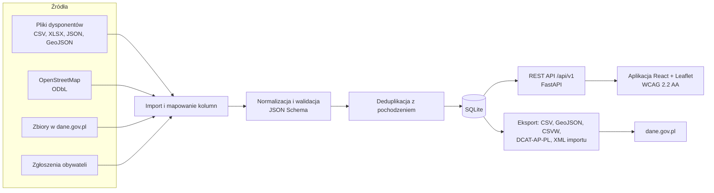

# AED w danych – otwarty zbiór defibrylatorów dla dane.gov.pl

**1 wiersz = 1 AED = szansa na życie.** Prototyp na HackNation 2026, zadanie Ministerstwa Cyfryzacji „Misja AED – dane na ratunek”. Zbiera dane o defibrylatorach AED z wielu źródeł, ujednolica je według wzorcowego zakresu danych i publikuje jako otwarty zbiór dla dane.gov.pl. Każdy może w nim szybko znaleźć najbliższe dostępne AED.

> Stan: wersja robocza (sob 13:30). Sekcje oznaczone „w toku” uzupełniamy w miarę postępu prac.

## Szybki start

### Cały system (backend + aplikacja) – w toku

```bash
cp .env.example .env
docker compose up --build
```

Aplikacja: http://localhost (port 80), API: http://localhost/api/v1, dokumentacja API: http://localhost/api/docs.

### Sama aplikacja (bez backendu, na danych przykładowych)

Wymaga Node.js 20+.

```bash
cd src/ui
npm install
npm run dev
```

Otwórz http://localhost:5173. Gdy API nie odpowiada, aplikacja sama przełącza się na dane przykładowe z `data/sample/` i pokazuje baner „Tryb demonstracyjny”.

## Ścieżki testowe dla jury

1. **Obywatel – najbliższe AED.** Strona główna → „Pokaż najbliższe AED” (albo „Użyj punktu w centrum Warszawy” w trybie demonstracyjnym) → lista 5 najbliższych z filtrem „Tylko dostępne teraz” → „Biblioteka Testowa” → na górze karty informacja, że szafka jest zamknięta, i instrukcja dostępu → „Paszport AED”: potwierdź, że urządzenie jest na miejscu.
2. **Dysponent – import pliku.** „Dla dysponentów” → pobierz szablon → wgraj `data/sample/zrodlo_gmina_przyklad.csv` → sprawdź dopasowanie kolumn → raport (zamiana „pn-pt 8-16” na `Mo-Fr 08:00-16:00`, scalony duplikat z OpenStreetMap) → zatwierdź → pobierz odznakę akcji.
3. **Programista / dane.gov.pl.** „Zbiór danych” → pliki CSV, GeoJSON, osobny zasób OSM (ODbL), pochodzenie, źródła, słownik danych, CSVW, metadane DCAT-AP-PL, XML importu; opis 44 pól; przykłady zapytań do API.
4. **Źródła.** „Źródła” → zakres referencyjny każdego źródła (liczba rekordów, pokrycie pól wymaganych i zalecanych, licencja, częstotliwość, obszar).
5. **Moderator.** Stopka → „Panel moderatora” → zgłoszenie obywatela → zatwierdź, scal albo odrzuć.

## Architektura



- Kontrakt API: [`docs/CONTRACT.md`](docs/CONTRACT.md). Szczegóły techniczne backendu: `docs/tech/` (w toku).
- Wzorcowy zakres danych: [`deliverables/zakres_danych/`](deliverables/zakres_danych/) i [`docs/schema/`](docs/schema/).
- Aplikacja: [`src/ui/`](src/ui/) – React 19 + TypeScript + Vite, mapa Leaflet wywoływana bezpośrednio, build statyczny serwowany przez nginx z przekazaniem `/api` do backendu.

## Zgodność z dane.gov.pl

W toku – skrót z `docs/tech/COMPLIANCE.md` po publikacji przez zespół backendu. Założenia z kontraktu: CSV na poziomie 3 (UTF-8, przecinek, RFC 4180), GeoJSON, API JSON ze stronicowaniem i filtrami, metadane pl/en w DCAT-AP-PL, CSVW, słownik danych, plik XML do automatycznego zasilania portalu, dane OpenStreetMap w osobnym zasobie na licencji ODbL.

## Dostępność

Cel: WCAG 2.2 na poziomie AA. Wyniki testów i zrzuty: [`docs/a11y/raport.md`](docs/a11y/raport.md).

- Lista najbliższych AED i lista na mapie zawierają te same informacje co mapa.
- Stan „dostępne teraz” jest zawsze pokazywany ikoną i tekstem, a na mapie kolorem, kształtem i znaczkiem.
- Pełna obsługa klawiaturą, link „Przejdź do treści”, widoczny fokus, cele dotykowe min. 44×44 px.
- Formularze: etykiety, podpowiedzi, błędy przy polach i w podsumowaniu, bez limitu czasu, bez danych osobowych.
- Układ działa od 320 px szerokości.

## Akcja „AED w danych”

Nazwa, hasło, logotyp i system znaczników na mapie wybrał zespół. Pliki logotypu i księga znaku: [`brand/`](brand/).

## Licencje

- Kod: zależności wyłącznie na licencjach MIT, BSD, Apache-2.0 lub ISC (sprawdzenie: `cd src/ui && npm run licenses`). Mapa: Leaflet (BSD-2-Clause) bez react-leaflet.
- Kafelki mapy i dane OpenStreetMap: © autorzy OpenStreetMap, licencja ODbL.
- Dane w prototypie są przykładowe i fikcyjne.

## Zakres użycia AI

Opis: [`docs/AI_USAGE.md`](docs/AI_USAGE.md).
